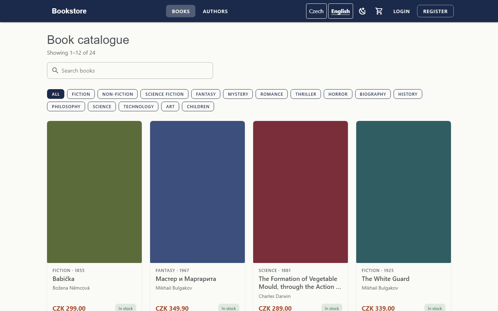
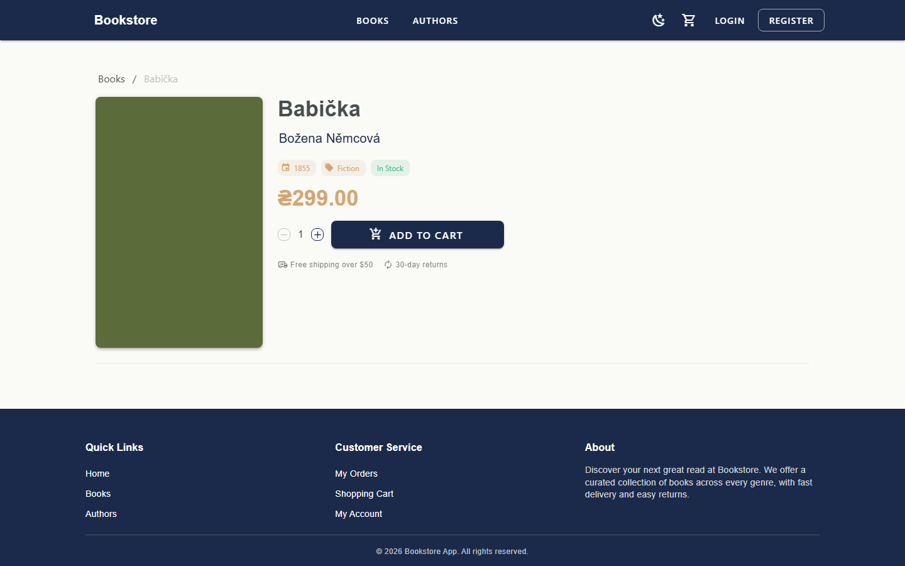
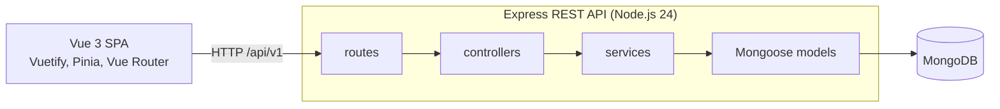

# Fullstack Bookstore

An online bookstore: a Vue 3 single-page application and a REST API on Express and MongoDB. It is a portfolio project
that shows how its author builds and maintains a full-stack application with tests, CI and written-down decisions.

## Status

The foundation is done: automated tests, CI, configuration checked at startup, a seed command and end-to-end tests.
The purchase path works from the catalogue to the order:

- The catalogue lists every book, page by page. The page, the search and the category are in the address, so Back,
  a reload and a shared link show the same list. A book card opens from the keyboard, its add-to-cart button is named
  after the book, and a book without a cover shows its title and author in the cover's place.
- The cart lives on the server. A guest cart is priced by the server and joins the account cart on sign-in.
- Checkout validates the delivery address, orders at the server's total and places an order at most once, also when
  the request is retried.
- My Orders lists the user's orders, shows each one with its history and cancels an order that is not paid yet.
- The profile edits first name, last name and username, shows email, changes the password and signs out all devices.
  A password change ends the previous sessions and keeps the current page signed in with one replacement token.
  New passwords use 15–128 Unicode code points after NFKC normalization, with common and account-related passwords
  rejected by the server. Existing shorter passwords still work at sign-in.
- Signing out and an expired session clear the session the same way; signing in returns to the page that asked for
  it.
- Sessions live on the server: signing out, deactivating an account or changing its role or password ends its
  sessions at once, and every protected request reads the user's role from the database. Failed sign-in attempts are
  limited per client, and sign-in takes the same time whether the account exists or not.
- The admin account opens the admin panel; other accounts get an access-denied page. An admin cannot take away their
  own admin role or deactivate their own account.
- The admin panel has its own layout and manages the books: a table loaded page by page from the API, with the
  search, filters, sort and page in the address; a form to add and edit a book; the stock switched in its row; and
  deletion after a confirmation. Its code loads only when an admin page opens.
- Authors have a server-side admin table too, with search and sort in the address and a form for their name,
  biography, birth year, country and website. An author with books cannot be deleted: the message gives the number
  of books to reassign or delete first. Book counts come from the books themselves, including after a move or deletion.
- Users have a server-side admin table with search, role and active-status filters, creation and profile editing,
  and confirmed activation or deactivation. The last active administrator is protected by the API.
- Orders have a filtered admin table and a separate detail page with the customer, delivery address, lines and
  history. The API supplies the allowed status and payment actions; recording a paid cancellation or refund asks
  the admin to return the money in the payment provider dashboard first. The app records the change only.
- The dashboard reads catalogue totals, user totals and active accounts, order counts, paid revenue and the latest
  five orders from server aggregates. Each resource has its own loading, error and retry state.
- The interface is in Czech (default) and English (`/en`), with prices in CZK. Delivery and VAT terms are built from
  the shop settings (`GET /api/v1/config/public`), which hold demo values.

Known limitations:

- There is no online payment: a new order waits for payment.
- Public author pages are still in English only. The Czech texts are a draft.
- Book categories are a fixed list, and their names are not translated yet.
- Development tools (nodemon, ESLint 7) still depend on packages with known vulnerabilities and no fix within their
  current major versions; [docs/dependency-audit.md](docs/dependency-audit.md) lists them with review dates.
- The seed data is for checking the layout; there is no real catalogue yet.

## Screenshots





## Tech stack

- **Frontend:** Vue 3, Vuetify 3, Pinia 3, Vue Router 4, Vite 6, Axios 1.
- **Backend:** Node.js 24.7+, Express 4, Mongoose 8, MongoDB, JWT (`jsonwebtoken` 9), native Argon2id, bcrypt 6 for legacy verification, Helmet 8.
- **Tests:** Vitest 4.1.11, Supertest 7.3.0, mongodb-memory-server 11.3.0, happy-dom 20.14.5, Playwright 1.63.0.
- **Tooling:** ESLint 7 and Prettier 2 (frontend), GitHub Actions.

## Architecture



The browser calls the API at the relative path `/api/v1`; in development and preview the Vite server forwards `/api` to
the API. A request passes through routes, controllers, services and Mongoose models, in that order. The backend
validates its configuration at startup and refuses to start on an invalid one, and a guard keeps tests and end-to-end
runs away from databases that are not local. [docs/architecture.md](docs/architecture.md) has the details.

## Key decisions

- [0001, Node.js 24 and validated configuration](docs/decisions/0001-node-24-and-validated-configuration.md): Node.js
  24 LTS is required, and the backend refuses to start on an invalid configuration.
- [0002, tests and a local-only database guard](docs/decisions/0002-test-infrastructure-and-local-database-guard.md):
  tests run on an in-memory MongoDB, and a guard keeps tests, seeding and end-to-end runs off remote databases by
  default.
- [0003, relative API base URL](docs/decisions/0003-relative-api-base-url.md): the frontend calls `/api/v1` on its own
  origin, and the Vite dev and preview servers proxy it to the API.
- [0004, dependency and CI policy](docs/decisions/0004-dependency-and-ci-policy.md): exact versions for new
  dependencies, new packages at least 14 days old, pinned CI actions and checks that never rewrite files.
- [0005, server sessions and sign-in protection](docs/decisions/0005-server-sessions-and-sign-in-protection.md): the
  token names a server session that signing out, deactivation and role or password changes end at once; failed
  sign-in attempts are limited per client, and sign-in takes the same time for every account.
- [0006, password policy and Argon2id](docs/decisions/0006-password-policy-and-argon2id.md): new-password validation,
  native hashing, compatible bcrypt upgrades, credential concurrency and replacement sessions.

## Getting started

Run each code block from the repository root; the install block starts one level above it.

### Requirements

- **Node.js 24.7 or newer within 24.x** (`.nvmrc`; the backend requires native Argon2id). Node 25 and newer are not supported:
  `jsonwebtoken` needs `SlowBuffer`, which Node 25 removed, so the backend does not start there. Install Node 24 with
  fnm (`fnm install`, then `fnm use`; both read `.nvmrc`), nvm-windows (`nvm install 24`, then `nvm use 24`) or volta
  (`volta install node@24`); `node -v` must print `v24.x.x`.
- **Docker** (optional) replaces a local Node 24: run npm in a `node:24` container, with `node_modules` in its own
  volume (native packages built on the host do not load on Linux). From the repository root; in Git
  Bash on Windows prefix the command with `MSYS_NO_PATHCONV=1` and write `$PWD` as a full path such as
  `D:/path/to/fullstack-bookstore-app`:
  ```bash
  docker run --rm \
    -v "$PWD/backend:/app" -v bookstore-backend-nm:/app/node_modules \
    -w /app node:24-bookworm-slim \
    sh -c "apt-get update -qq && apt-get install -y -qq --no-install-recommends libcurl4 && npm ci && npm test"
  ```
  `libcurl4` is there because the slim image lacks it and the tests' `mongod` will not start without it. The frontend
  needs its own volume (for example `bookstore-frontend-nm`): `esbuild` and `rollup` ship platform-specific binaries.
- **MongoDB**, reachable from your machine. The examples use `mongodb://127.0.0.1:27017/bookstore`. To run it in Docker:
  ```bash
  docker run -d --name bookstore-mongo -p 127.0.0.1:27017:27017 mongo:7.0
  ```

### Install and configure

```bash
# each package has its own package.json and lock file: install both with npm ci
git clone https://github.com/ArtemMasharipov/fullstack-bookstore-app.git
cd fullstack-bookstore-app
cd backend
npm ci
cd ../frontend
npm ci
cd ..
```

Copy the backend example (an existing `backend/.env` is kept), generate a `JWT_SECRET` and paste it after
`JWT_SECRET=` in `backend/.env`; the backend and the seed command refuse to start without it:

```bash
cp -n backend/.env.example backend/.env
node -e "console.log(require('crypto').randomBytes(32).toString('hex'))"
```

```powershell
if (-not (Test-Path backend/.env)) { Copy-Item backend/.env.example backend/.env }
```

`backend/.env` is git-ignored. Its variables (the common ones are in `backend/.env.example`):

| Variable                                       | Meaning                                                                                         |
| ---------------------------------------------- | ----------------------------------------------------------------------------------------------- |
| `NODE_ENV`                                     | `development`, `test` or `production`; default `development`                                    |
| `PORT`                                         | API port; default `3000`                                                                        |
| `MONGODB_URI`                                  | Connection string; default `mongodb://localhost:27017/bookStoreDB`                              |
| `MONGODB_URL`, `DATABASE_NAME`                 | The older form of `MONGODB_URI`; in production one of the two forms is required                 |
| `JWT_SECRET`                                   | **Required everywhere**; at least 32 characters in production                                   |
| `JWT_EXPIRATION`, `JWT_AUDIENCE`, `JWT_ISSUER` | Defaults `7d`, `bookstore-web` and `bookstore-api`; every request checks audience and issuer    |
| `CORS_ORIGIN`                                  | Allowed browser origin; default `http://localhost:8080`; in production **required and not `*`** |
| `CORS_METHODS`, `CORS_CREDENTIALS`             | Optional; defaults `GET,POST,PUT,PATCH,DELETE` and `false`                                      |
| `AUTH_RATE_LIMIT_MAX`                          | Failed requests to `/api/v1/auth` per client in the window before 429; default `10`             |
| `AUTH_RATE_LIMIT_WINDOW_MINUTES`               | The length of that window in minutes; default `15`                                              |
| `TRUST_PROXY`                                  | Reverse proxies in front of the API, so the limit sees each client's address; default `0`       |
| `EXPOSE_ERROR_DETAILS`                         | `true` puts error messages and stack traces into responses; ignored in production               |
| `COMMERCE_VAT_RATE_PERCENT`                    | VAT rate included in prices, whole percent; demo default `0` (books are zero-rated in Czechia)  |
| `COMMERCE_SHIPPING_FEE`                        | Shipping fee in geller (1/100 CZK); demo default `9900`                                         |
| `COMMERCE_FREE_SHIPPING_THRESHOLD`             | Order total in geller from which shipping is free; demo default `100000`                        |
| `SEED_ADMIN_PASSWORD`, `SEED_USER_PASSWORD`    | Passwords for `npm run seed` (see [Seed demo data](#seed-demo-data))                            |
| `SEED_ALLOW_REMOTE`                            | Allows seeding a non-local database; set it in the shell for one run, never in `backend/.env`   |

The configuration is validated at startup: an invalid value stops the process with a list of every problem, and an empty
value (`JWT_SECRET=`) counts as not set. `backend/.env` is read only by `server.js` and the seed command, from the
current directory, so run them from `backend/`; tests and the e2e server never read it. A variable already set in your
shell wins over `.env`. The frontend needs no configuration: its API base URL is `/api/v1` unless `VITE_API_URL` is set
(see `frontend/.env.example`) when the dev server starts or the app is built.

### Run

```bash
# terminal 1: the API on http://localhost:3000 (MongoDB must be running)
cd backend
npm run dev      # nodemon; `npm start` runs the server once, without nodemon

# terminal 2: the frontend on http://localhost:8080 (it opens the browser itself); the catalogue is at /books
cd frontend
npm run dev
```

nodemon does not watch `backend/.env`: after you edit it, type `rs` and press Enter in the nodemon terminal. The same
applies after a startup error such as a missing `JWT_SECRET`, when nodemon prints
`app crashed - waiting for file changes before starting...`. Check the API with
`curl http://localhost:3000/api/v1/health`; in Windows PowerShell use `curl.exe`, because plain `curl` is an alias of
`Invoke-WebRequest`. It answers `200` with `{"success":true,"message":"API is running",...}`.

The dev server proxies every `/api` request to `http://localhost:3000`. If the API runs elsewhere, set
`API_PROXY_TARGET` in the shell (it is not read from `.env` files) before starting it:
`API_PROXY_TARGET=http://localhost:3001 npm run dev` in bash,
`$env:API_PROXY_TARGET = 'http://localhost:3001'; npm run dev` in PowerShell.

### Seed demo data

The catalogue is empty until you seed the database. `npm run seed` creates 2 users (`admin@bookstore.local` with the
`admin` role, and `reader@bookstore.local`), 5 authors and 24 books: test data for checking the layout.

```bash
cd backend
SEED_ADMIN_PASSWORD='choose-a-password' SEED_USER_PASSWORD='choose-another-one' npm run seed
```

```powershell
cd backend
$env:SEED_ADMIN_PASSWORD = 'choose-a-password'; $env:SEED_USER_PASSWORD = 'choose-another-one'; npm run seed
```

- **Passwords** come from the two variables (the shell or `backend/.env`; 15–128 code points after NFKC normalization,
  excluding common passwords, username, email local part and Bookstore). Validation happens before reset or writes. A missing one is
  generated and printed once in an interactive terminal; without a terminal it is an error.
- **Only a local database** (`localhost`, `127.0.0.1`, `::1`) is seeded. For another one set `SEED_ALLOW_REMOTE=true`
  in the shell for that one run: `SEED_ALLOW_REMOTE=true npm run seed`.
- **A seeded database is refused** (`Database already seeded; run with --reset`). `npm run seed -- --reset` (the flag
  goes after `--`) deletes all users, authors and books first (carts and orders stay) and works only on a local one.

## Tests and checks

```bash
# in backend/
npm test                            # Vitest, Supertest, in-memory MongoDB
npm audit --omit=dev --audit-level=high   # no high or critical finding in production dependencies

# in frontend/
npm test                            # Vitest, happy-dom
npm audit --omit=dev --audit-level=high   # the same check for the frontend
npx playwright install chromium     # once; on Linux add --with-deps
npm run test:e2e                    # Playwright end-to-end tests
npm run lint                        # ESLint, only checks (the backend has no linter yet)
npm run format:check                # Prettier, only checks
npm run lint:fix                    # ESLint --fix, changes files
npm run format                      # Prettier --write, changes files
npm run build                       # writes to dist/ in the repository root
npm run preview                     # serves the build on port 4173, proxies /api like the dev server
```

- **Backend tests** need neither `backend/.env` nor a MongoDB of your own. The first run downloads a `mongod` binary
  (8.2.6, pinned in `backend/package.json`) into `~/.cache/mongodb-binaries`, so it needs network access. The SIGTERM
  and SIGINT shutdown tests are skipped on Windows.
- **End-to-end tests.** The catalogue, both languages, the cart, checkout and orders. Playwright starts its own stack: the API
  on port 3100 (in-memory MongoDB with the seed data) and `vite preview` of a fresh build on port 4173. It needs
  `npm ci` in `backend/` as well, fails if either port is busy and never reuses a running dev server.
- **CI** (`.github/workflows/ci.yml`) runs on pull requests and pushes to `main`: a `backend` job (`npm ci`,
  `npm test`), a `frontend` job (`npm ci`, `lint`, `format:check`, `test`, `build`) and an `e2e` job.

## Development workflow

The project is developed with AI coding agents under the author's direction: Claude Code with the open-source
[Superpowers](https://github.com/obra/superpowers) skills, and Cursor before that (commits it helped with carry a
`Co-authored-by: Cursor` trailer). Since October 2026, every change goes through the same loop:

1. an audit of the current state and short decision records;
2. a written specification for the stage;
3. a plan of small tasks, each with its own check;
4. a failing test first, then the code;
5. an independent review of every task and of the whole branch;
6. automated checks: unit, integration and end-to-end tests, ESLint and Prettier, CI on every pull request and push to `main`;
7. a secret scan of the history before publishing.

Agent output is treated as unverified until tests and review confirm it.
[Decision 0004](docs/decisions/0004-dependency-and-ci-policy.md) lists defects that the reviews caught. Specifications,
plans and review notes are kept private; decision records are in [docs/decisions](docs/decisions).

## Project history

Development started in December 2024. The public history is condensed: the original commits were grouped into commits
that each describe one meaningful change, with their original dates. Files that never belonged in version control and
internal planning documents were left out of every commit.

## Copyright

Copyright (c) 2024–2026 Artem Masharipov. All rights reserved. See [LICENSE](LICENSE).
