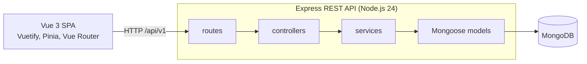

# Architecture

Fullstack Bookstore is a Vue single-page application with an Express REST API and MongoDB behind it. This page shows how
the parts fit together. Setup and commands are in the [README](../README.md), the full list of API routes is in
[backend/README.md](../backend/README.md#api), and the reasons behind the main choices are in the
[decision records](decisions/).

## Overview

The repository holds two npm packages, each with its own `package.json` and lock file: `backend/` (Express, Mongoose)
and `frontend/` (Vite, Vue 3). The browser calls the API at the relative path `/api/v1`. In development and preview the
Vite server forwards `/api` to the API, so the browser sees a single origin. Some features are not finished yet; the
README lists them.

## Backend

- **Entry points.** `server.js` runs the API (`npm start`, `npm run dev`). Its first import, `config/load-env.js`, loads
  `backend/.env`; then it loads the configuration and the app, connects to MongoDB and listens. `app.js` builds the
  Express app: Helmet security headers, CORS, JSON and form parsing, request logging (off when `NODE_ENV=test`), the
  API under `/api/v1`, a JSON 404 and the error handler. It neither listens nor connects, so tests import it directly.
- **Configuration** (`config/`). `default.js` exports `loadConfig(env)`, which validates an environment object and
  throws a `ConfigError` that lists every problem; its default export is the validated configuration of the process.
  `load-env.js` reads `.env`, and only the entry points import it: `server.js` and the seed command. `database.js`
  connects Mongoose. `mongo-guard.js` refuses database hosts that are not local in tests, seeding and end-to-end runs
  ([decision 0002](decisions/0002-test-infrastructure-and-local-database-guard.md)).
- **Layers.** A request passes through `routes/`, `controllers/`, `services/` and `models/`, in that order. A route
  file maps paths to controllers and declares access with the `protect` and `authorize("admin")` middleware. A
  controller reads the request, calls a service and sends the JSON response. A service holds the business logic and
  reports failures with the error classes of `utils/errors.js` (400, 401, 403, 404, 409). A model is a Mongoose schema
  with validation, indexes and hooks.
- **Middleware** (`middleware/`). In `auth.js`, `protect` verifies the `Authorization: Bearer <token>` JWT with
  `JWT_SECRET` and puts its payload (user id, username, email, role) on `req.user`; `authorize(...roles)` checks the
  role. `validate.js` checks the params, query and body of a route against its zod schemas (`schemas/`) and puts the
  parsed values on `req.valid`. `errorHandler.js` comes last and answers every error as
  `{ success: false, error: { code, message, fields?, details? } }`: failed validation, Mongoose validation errors and
  malformed ids become 400 `VALIDATION_FAILED` with the invalid `fields`, duplicate keys 409 `CONFLICT`, and the app's
  own errors keep their status and code. Any other error keeps its own status code or gets 500 `INTERNAL`, and its
  message is replaced with `Internal server error`. The handler logs 5xx errors with their stack and 4xx errors as one
  warning line with the status and the code, never a value from the request. `requestLogger.js` logs one line per
  response: method, path without the query string, status and duration.
  `asyncHandler.js` passes errors of async handlers on to the error handler.
- **API.** `routes/index.js` mounts the routers under `/api/v1`, grouped as `/books`, `/authors`, `/auth`, `/users`,
  `/cart`, `/orders` and `/config`. `GET /api/v1/health` answers 200 with `API is running`.
- **Shutdown.** On SIGTERM or SIGINT the server stops accepting connections, waits for open requests, closes the
  MongoDB connection and exits with 0. An unhandled rejection or an uncaught exception takes the same path and exits
  with 1. If the cleanup has not finished after 10 seconds, the process prints `shutdown timed out` and exits with 1.

## Data model

Six Mongoose models live in `backend/models/`. All but `Counter` have `createdAt` and `updatedAt` timestamps.

| Model | Key fields | Relations |
| --- | --- | --- |
| `Author` | `firstName`, `lastName`, `bio`, `birthYear`, `country`, `website` | `books`: ids of the author's books |
| `Book` | `title`, `publicationYear` (1450 up to the current year), `category`, `description`, `price`, `image`, `inStock` | `author` (an `Author`, required) |
| `User` | `username` and `email` (both unique), `password` (bcrypt hash, left out of query results by default), `role` (`user`, `admin`, `moderator`), `isActive`, `lastLogin` | none |
| `Cart` | `items` (`book`, `quantity` from 1 to 99) | `user` (a `User`, one cart each); `items.book` (a `Book`) |
| `Order` | `orderNumber` (`ORD-YYYYMMDD-NNNNNN`), `items` (`book`, `title`, `unitPrice`, `quantity`, `lineTotal`), `shippingAddress`, `quote`, `status`, `paymentStatus`, `statusHistory`, `idempotencyKey`, `requestHash`, `schemaVersion: 2` | `user` (a `User`); `items.book` (a `Book`) |
| `Counter` | `_id` (the sequence name, `order:YYYYMMDD`), `seq` | none |

- Saving a book adds it to its author's `books` list.
- A cart keeps no prices. `services/cartService.js` prices it on every request from the books as they are now, in
  whole geller (1/100 CZK), and `services/pricing.js` builds the quote: lines of deleted or out-of-stock books do not
  count, shipping is free from a threshold, and VAT is part of the total. The VAT rate, the shipping fee and the
  threshold come from `config.commerce` (demo defaults: 0 %, 99 Kč, 1000 Kč).
- Every cart change is one atomic update of one line (`$inc`, `$push`, `$pull` on the cart document), so changes made
  at the same moment from two tabs, a merge or an order never undo each other.
- An order is placed from the user's cart (`services/orderService.js`):
  1. The client creates an `Idempotency-Key` (a UUID) for each checkout and sends it with the address and the total
     the customer saw. A request that repeats an earlier one (same key, same body) answers the order it placed; the
     same key with another body is refused.
  2. The server prices the cart again. An empty cart, an unavailable book or a total that is no longer the current
     one is refused before anything is stored; a changed total comes back with the new quote for the customer to
     confirm with the same key.
  3. The number comes from an atomic counter per UTC day (`Counter`), the order stores its lines, the quote and the
     address, and a unique index on the user and the key settles two identical requests at the same moment.
  4. The ordered lines leave the cart, but only while their quantity is the ordered one: a line changed meanwhile
     stays. There is no transaction yet; a retry with the same key answers the order if this step did not run.
- `status` is one of `pending`, `processing`, `shipped`, `delivered` or `cancelled`; `paymentStatus` is `unpaid`,
  `paid` or `failed`, and every change of either is added to `statusHistory`. A customer can cancel a pending order
  that is not paid.
- Orders stored before `schemaVersion: 2` (float amounts in crowns, `isPaid`, the street in `address`) are never
  rewritten. `services/orderView.js` reads both shapes into the same order view, converting the old amounts to geller.
- The server builds every declared index before it takes requests (`ensureIndexes` in `config/database.js`); the
  order idempotency key depends on its unique index.

## Request path

How the catalogue page gets its books, from the browser to MongoDB and back:

1. On `/books` the router renders `BooksView`. Its `BookList` component (`components/features/books`) reads the page,
   the search and the category from the address (`router/catalogQuery.js`) and asks the books store for that page
   whenever the address changes. Paging and choosing a category change the address first, so Back, a reload and a
   shared link show the same list.
2. The store calls `booksApi.fetchAll()` with `page`, `limit` (12) and the search and the category when they are set.
   It keeps only the answer of its latest request, so a quick Back or typing never shows an older list.
3. `booksApi` sends the request through the shared Axios instance in `services/api/baseApi.js`. Its base URL is
   `/api/v1`, so the browser asks the origin that served the page for `GET /api/v1/books?page=2&limit=12`.
4. The Vite server forwards `/api` to the API at `API_PROXY_TARGET` (default `http://localhost:3000`): the dev server
   on port 8080 in development, the preview server on port 4173 in a preview.
5. Express runs the global middleware (Helmet, CORS, body parsing, request logging). The `/api/v1` router hands the
   request to `routes/books.js`, where `GET /` is public. `validate({ query: listBooksQuery })` checks the query first:
   an unknown parameter, a page below 1, a limit above 100, a sort outside the list or a value sent twice or as an
   object answers 400 `VALIDATION_FAILED`.
6. The controller passes the parsed query (`req.valid.query`) to `bookService.getBooks()`.
7. The service builds the filter: the category and the author match as whole values, the search matches part of the
   title or the description as plain text. It runs two queries at once: `Book.find()` with the author's first and last
   name populated, newest first with `_id` breaking ties (so no book shows on two pages), skipped and limited to the
   requested page, and `Book.countDocuments()` for the total.
8. Mongoose sends both queries to MongoDB and returns the documents as plain objects (`lean()`).
9. `services/bookView.js` turns each document into the book view (`id`, no `_id` or `__v`, the author as
   `{ id, firstName, lastName }`), and the controller answers 200 with `{ success: true, data, pagination }`:
   `pagination` holds `page`, `limit`, `total` and `pages`. The request logger prints
   `GET /api/v1/books 200 <duration>ms`.
10. The store keeps the books and the server's pagination, and `BookList` renders the cards, the count and the pager.

If the query is invalid or any step throws, the error handler answers `{ success: false, error: { code, message } }`
with the matching status, and the catalogue shows the translated message with Try again.

## Frontend

`frontend/` is a Vite project: Vue 3 with Vuetify, Pinia and Vue Router. `src/main.js` creates the app and installs
the three plugins.

- **Router** (`src/router/`). `manifest.js` is the single list of routes: path, lazily loaded view, page title and an
  access policy (`auth`, `guestOnly`, `permission`). `buildRoutes.js` turns it into Vue Router records, passes a
  layout's policy down to its children and builds the admin sidebar from the same list. `guards/unified.js` is the one
  `beforeEach` guard: public routes pass at once; otherwise it checks that the stored token has not expired and sends
  the user to the login page, the home page or the "access denied" page as the policy requires. The login page gets
  the way back in `?redirect`; after signing in, `redirect.js` opens it only if it is a path to a page of this app,
  and opens it in the current language, otherwise the home page. The API checks every protected request on its own.
  `catalogQuery.js` reads the catalogue's page, search and category from the address and writes them back in one
  canonical form: no first page, no empty values, an invalid page replaced.
- **State** (`src/stores/`). One Pinia store per area: `auth`, `authors`, `books`, `cart`, `checkout`, `orders`,
  `shopConfig` and `users`. The stores call their API modules and track their loading and error state.
  - `books` holds one page of books with the server's pagination. Search and filters are not kept there: the
    catalogue reads them from its address, and the home page loads its latest books into a list of its own.
  - `shopConfig` loads the shop settings of `GET /config/public` once; the home page and the book page state shipping
    and VAT only from them.
  - The cart store holds the server's lines and quote and runs its changes one after another; a guest cart keeps only
    book ids and quantities in `localStorage`, is priced by `POST /cart/quote` and is merged into the account cart on
    sign-in.
  - The checkout store holds the idempotency key of the current checkout and keeps it for every retry of the same
    order.
- **API client** (`src/services/api/`). One module per resource (`booksApi.js`, `authorsApi.js`, `cartApi.js`,
  `orderApi.js`, `configApi.js`, `usersApi.js`, `rolesApi.js`, `authService.js`), all on the Axios instance in
  `baseApi.js`. It sets
  the base URL and a 15-second timeout, adds the token from `localStorage` to protected requests, turns failures into
  `Error` objects that carry the status and the `code`, `fields` and `details` of the error envelope, and ends the
  session after a 401 to a request that carried the token. A 401 without a token, such as a wrong password, ends
  nothing.
- **Session** (`src/services/session.js`). Signing out, a 401 and an expired token end the session the same way:
  the token, the user data, the guest cart key, the notifications and every store except the public catalogue and
  shop settings are cleared. The cart also drops answers of requests that were still running. A page that needs an
  account is then replaced by the login page in the same language: after a 401 or an expired token with the way back
  in `?redirect`, after signing out without it, so the next person on the device does not land on the previous
  user's page. A public page stays open for the visitor as a guest.
- **Design tokens** (`src/design/`). `tokens.js` holds the colours that text contrast and the focus ring depend on;
  `config/vuetify.js` builds the theme from them, and `tokens.spec.js` checks every pair against the WCAG 2.x
  thresholds. `focus.css` draws a two-tone focus ring on links and buttons, with the colours swapped on navy surfaces
  and in the dark theme.
- **Components and views.** `src/components/features/` holds the components of each area: `admin`, `auth`, `authors`,
  `books`, `cart`, `orders`. In `books`, `BookCard` links its title over the whole card and names its add-to-cart
  button after the book, and `BookCover` keeps a 2:3 box with the title and the author when there is no image.
  Shared pieces live in `components/ui`, `components/layout` and `components/notifications`. `src/views/` holds the
  pages that the router loads, grouped as `public`, `auth`, `orders`, `admin` and `errors`.

## Configuration and environments

The backend reads its settings from environment variables and checks them at startup
([decision 0001](decisions/0001-node-24-and-validated-configuration.md)). The [README](../README.md) lists them all;
the key ones are:

- `MONGODB_URI`: default `mongodb://localhost:27017/bookStoreDB`, required in production (the older `MONGODB_URL`
  also works);
- `JWT_SECRET`: required everywhere, at least 32 characters in production;
- `PORT`: default 3000;
- `CORS_ORIGIN`: default `http://localhost:8080` outside production, required and not `*` in production;
- `EXPOSE_ERROR_DETAILS`: `true` adds error messages and stack traces to responses, outside production only.

The frontend uses two: `VITE_API_URL`, the API base URL built into the bundle (default `/api/v1`), and
`API_PROXY_TARGET`, where the dev and preview servers forward `/api` (default `http://localhost:3000`). `vite.config.js`
reads `API_PROXY_TARGET` from the process environment
([decision 0003](decisions/0003-relative-api-base-url.md)).

| Environment | Frontend | API | Database |
| --- | --- | --- | --- |
| Development | `npm run dev`: Vite on 8080, proxies `/api` to 3000 | `npm run dev` (nodemon) or `npm start` on 3000 | `MONGODB_URI` from `backend/.env` |
| Tests | Vitest on happy-dom | Vitest and Supertest against `app.js` | in-memory MongoDB |
| End-to-end | `vite preview` of a fresh build on 4173, proxies `/api` to 3100 | `npm run e2e:server` on 3100 | in-memory MongoDB with the demo data |

`npm run build` writes the bundle to `dist/` in the repository root and empties that directory first. esbuild minifies
the code and drops `console.log`, `console.info` and `console.debug` calls. By default the bundle names no API host, so
a production web server has to forward `/api` to the API; the other option is to build with an absolute
`VITE_API_URL`.

## Testing

- **Backend.** Vitest with Supertest. Unit tests (`tests/unit/`) cover the configuration, the database guard, the
  error handler, the request logger and `.env` loading. Integration tests (`tests/integration/`) call the API over
  HTTP and run the seed command, the end-to-end server and `server.js` start-up and shutdown in child processes. Tests
  of the SIGTERM and SIGINT handling run on Linux and are skipped on Windows.
- **Database.** One in-memory MongoDB (mongodb-memory-server, mongod 8.2.6 pinned in `backend/package.json`) serves
  the whole run. Each Vitest worker uses its own database, and collections are emptied after every test. The test
  helper passes the URI through the local-only guard before it connects and checks the connected host after. With
  `NODE_ENV=test` the `.env` loader does nothing, so the database URI in `backend/.env` never reaches the tests
  ([decision 0002](decisions/0002-test-infrastructure-and-local-database-guard.md)).
- **Characterization tests** (`tests/integration/characterization.test.js`) record the API's correct behavior before
  the refactoring: health, registration and login, `/auth/me`, the book list and lookup, admin-only book creation.
  They must not pin known defects.
- **Frontend.** Vitest on happy-dom runs `src/**/*.spec.js`: the API modules, the stores, the utilities, the design
  tokens, the catalogue's address, and the components and views of the catalogue, the book page, the home page, the
  sign-in and registration forms, the cart, checkout and orders, mounted with the real router, i18n and Vuetify.
- **End-to-end.** Playwright in Chromium runs `frontend/e2e/`: the catalogue smoke test, paging, search and categories
  in the address with Back, reload and a language switch, the keyboard path to a book, contrast, the focus ring,
  reflow at 320 px and target sizes on the catalogue pages, layout shift while books load, the Czech and English flows
  with accessibility checks, the server cart, checkout with retries, price changes and order cancellation, the whole
  purchase journey from a guest cart to a cancelled order and sign-out in both languages, expired sessions, and the
  shop terms against `GET /config/public`. Shared helpers live in `e2e/support.js`.
  Playwright starts its own servers on dedicated ports: the API on 3100 (`npm run e2e:server`, an in-memory MongoDB
  with the demo data) and `vite preview` on 4173. Existing servers are never reused, so a busy port fails the run
  instead of testing a dev stack.

## CI

`.github/workflows/ci.yml` runs on every pull request and on pushes to `main`: three jobs on `ubuntu-24.04`, with
Node.js taken from `.nvmrc`.

| Job | Steps | Timeout |
| --- | --- | --- |
| `backend` | `npm ci`, `npm test`; the mongod binary is cached between runs | 15 min |
| `frontend` | `npm ci`, `npm run lint`, `npm run format:check`, `npm test`, `npm run build` | 15 min |
| `e2e` | after both: `npm ci` in both packages, Chromium, `npm run test:e2e`; the Playwright report is kept on failure | 25 min |

Every action is pinned to a full commit SHA with its version in a comment. The workflow token can only read the
repository, and `actions/checkout` does not keep the credentials. CI only checks: `lint` and `format:check` never
change files ([decision 0004](decisions/0004-dependency-and-ci-policy.md)).
